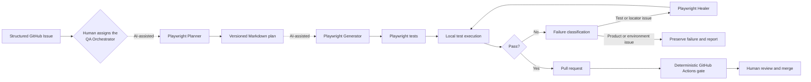

# Agentic QA with Playwright

An end-to-end agentic QA workflow that transforms a product requirement into validated Playwright test coverage through
automated planning, test generation, execution, failure analysis, and guarded test healing.

This is a small, reproducible QA/SDET portfolio project. AI assists with reasoning and test creation; Playwright and
GitHub Actions decide whether the checks pass; a human decides whether a pull request is merged.

## Architecture



| Layer | Responsibility | Authority |
| --- | --- | --- |
| AI-assisted | Interpret the Issue, explore the app, write a plan and tests, classify failures, propose safe healing | May change plans and tests within guardrails |
| Deterministic automation | Typecheck, build, execute Chromium tests, retain reports and failure evidence | Produces the actual pass/fail signal |
| Human | Supply the requirement, approve agent use, review product-defect reports and pull requests | Sole merge authority |

## Demo requirement

The self-contained **Northstar Supply** demo cart provides one realistic feature without relying on an unstable external
site:

> A user can increase and decrease product quantity, totals are recalculated, and quantity cannot become lower than 1.

The completed portfolio example is intentionally not assigned a fake Issue or pull-request number:

```text
Example requirement (no GitHub Issue)
  → specs/examples/shopping-cart-quantity.plan.md
  → tests/examples/shopping-cart-quantity.spec.ts
  → local Chromium validation
```

A real Issue uses this traceability chain:

```text
Issue #42
  → specs/issues/42-shopping-cart-quantity.plan.md
  → tests/issues/42-shopping-cart-quantity.spec.ts
  → PR linked to Issue #42
```

## Repository structure

```text
.github/
  ISSUE_TEMPLATE/             Structured request for automated coverage
  agents/                     QA Orchestrator and Playwright specialist agents
  prompts/                    Official Playwright agent-loop prompts
  workflows/                  Deterministic CI and Copilot environment setup
  copilot-instructions.md     Repository-wide safety and engineering rules
  pull_request_template.md    Traceability, execution, and healing evidence
.vscode/mcp.json              Local Playwright Test MCP configuration
specs/
  examples/                   Completed, clearly marked portfolio plan
  issues/                     Plans generated from real Issues
src/                          Small TypeScript demo storefront
tests/
  examples/                   Completed Playwright example
  fixtures/                   Typed Playwright fixtures
  issues/                     Tests generated from real Issues
  page-objects/               Encapsulated pages with private locators
  seed.spec.ts                Fresh-state seed used by the Planner
  test-data/                  Typed reusable scenario data
  types/                      Test-domain interfaces
playwright.config.ts          Chromium, evidence, reporting, and local web server
```

## Local setup

Prerequisites: Node.js 24 and npm.

```bash
npm ci
npx playwright install chromium
npm run validate
```

Useful commands:

```bash
npm run dev          # open the demo at http://127.0.0.1:4173
npm test             # run all Playwright tests
npm run test:ui      # inspect tests in Playwright UI mode
npm run test:report  # open the most recent HTML report
```

`npm run validate` is the local quality gate: TypeScript typecheck, production build, and the complete Playwright suite.

## Test architecture

The suite uses a deliberately small Page Object layer suited to the size of the demo:

- `ShoppingCartPage` owns all locators as private getters.
- Public methods describe user intent (`increaseQuantity`, `decreaseQuantity`) or return typed data (`getQuantity`,
  `getTotals`, `getState`). Raw Playwright locators never leak into specs.
- Reusable compound assertions (`expectState`, `expectMinimumQuantityEnforced`) stay next to the UI contract they check.
- A typed Playwright fixture supplies the Page Object to tests, while scenario values live in typed test data.
- Interfaces model structured cart state. Enums are intentionally omitted because this flow has no domain choice that is
  clearer as an enum than as explicit action methods.

This keeps specs readable without introducing a component hierarchy or base-page abstraction before the application
actually needs one.

## From Issue to pull request

1. Create an **Automated test coverage** Issue and complete every required field.
2. Assign the Issue to GitHub Copilot and select the `qa-orchestrator` custom agent. Issue assignment creates a pull
   request and requests human review when the agent finishes.
3. The Orchestrator validates the request and hands planning to `playwright-test-planner`.
4. The Planner explores from `tests/seed.spec.ts` and writes `specs/issues/<number>-<slug>.plan.md`.
5. The Orchestrator hands that plan to `playwright-test-generator`, which creates the matching Issue test.
6. The generated test runs. Every failure is classified before any healing is attempted.
7. Only test implementation and locator/synchronization failures may be handed to `playwright-test-healer`.
8. The pull request records its Issue, plan, test, validation result, classification, and any healing performed.
9. GitHub Actions performs a fresh, independent execution. A human reviews and merges; agents never merge.

In an IDE or Copilot environment with subagent prompt support, run the
`.github/prompts/playwright-test-coverage.prompt.md` prompt to chain the three Playwright specialists. If the current
host cannot invoke another custom agent, the Orchestrator is required to stop at the handoff and name the next agent
instead of silently duplicating its responsibility.

## Agent responsibilities

- **QA Orchestrator** validates Issue inputs, coordinates handoffs, runs quality gates, classifies failures, and prepares
  the pull-request evidence. It does not write plans or generated tests itself.
- **Planner** explores the permitted application route and converts acceptance criteria into a versioned Markdown plan.
- **Generator** executes plan steps against the live app and creates traceable, accessible, assertion-rich tests.
- **Healer** investigates evidence and edits tests only when the failure is demonstrably in test implementation,
  location strategy, or synchronization.

The three specialist profiles and prompt templates were generated by Playwright 1.64 with:

```bash
npx playwright init-agents --loop=copilot --prompts
```

Playwright recommends regenerating these definitions after upgrades. Reapply and review this repository's traceability
and safety sections when doing so.

## Failure classification and healing rules

Every failed test receives exactly one classification:

1. **Test implementation issue** — healing is allowed.
2. **Locator or synchronization issue** — healing is allowed.
3. **Environment or infrastructure issue** — report it; do not rewrite the test.
4. **Probable application or product defect** — preserve the failing expectation and report expected versus actual
   behavior.

Agents must never edit application behavior to force a pass, weaken or delete an assertion, add arbitrary sleeps, hide
a failure with `skip`/`fixme`, reduce an acceptance criterion, or merge a pull request.

## Deterministic CI

`.github/workflows/playwright.yml` runs for pushes and pull requests to `main`, and can also be dispatched manually. It:

1. installs lockfile-pinned dependencies with `npm ci`;
2. installs only Playwright Chromium and its Linux dependencies;
3. typechecks and builds the demo application;
4. runs Playwright independently of any AI decision;
5. uploads the HTML report, plus traces, screenshots, and video retained for failures.

For a stronger human gate, configure a GitHub ruleset for `main` that requires the **Typecheck, build, and test** check
and at least one approving pull-request review. Do not enable automatic merge for agent-authored changes.

## One-time GitHub configuration

Repository files cannot enable account-level Copilot features or branch protection. A repository administrator must:

1. enable GitHub Actions and GitHub Copilot cloud agent for this private repository;
2. create the `qa-automation` label used by the Issue Form;
3. configure the Playwright Test MCP server under **Settings → Copilot → Coding agent → MCP configuration** using the
   same `playwright-test` server generated in the agent profiles;
4. add the `main` ruleset described above;
5. assign a coverage Issue to Copilot and select `qa-orchestrator`, or invoke the agent manually from the Agents UI.

No repository secret is required for the deterministic Playwright workflow.

## Current integration boundaries

- Playwright officially provides Planner, Generator, and Healer profiles through `init-agents`; their output remains AI
  work and must be reviewed.
- GitHub supports repository custom agents in `.github/agents/` and lets a user choose one when assigning an Issue to
  Copilot. Assignment is a user/account action, not something ordinary committed repository files can enable.
- GitHub's API can assign an Issue to Copilot and select a custom agent, but this capability is in public preview and
  requires a personal access token, OAuth token, or GitHub App **user-to-server** token with broad write permissions.
  This project deliberately does not store such a credential or auto-dispatch agents from the CI workflow.
- Multi-agent chaining and prompt-file behavior differ between GitHub.com, Copilot CLI, and IDE hosts. The included
  Orchestrator fails closed at unsupported handoffs rather than pretending another specialist ran.
- The local demo is the required CI target. Production sites such as Google or iHerb are unsuitable as a merge gate due
  to bot defenses, regional consent flows, A/B tests, and changing data. A future external smoke suite should be
  read-only, explicitly tagged, and non-blocking.

Official references: [Playwright Test Agents](https://playwright.dev/docs/test-agents),
[GitHub custom agents](https://docs.github.com/en/copilot/concepts/agents/cloud-agent/about-custom-agents),
[assigning an Issue to a Copilot agent](https://docs.github.com/en/copilot/how-tos/copilot-on-github/use-copilot-agents/kick-off-a-task),
and [Copilot cloud agent API](https://docs.github.com/en/copilot/how-tos/use-copilot-agents/cloud-agent/use-cloud-agent-via-the-api).

## Recommended next improvement

After the first real Issue is processed, add a small schema checker that validates Issue-to-plan-to-test references and
run it before Playwright in CI. That strengthens traceability without introducing another AI dependency.
